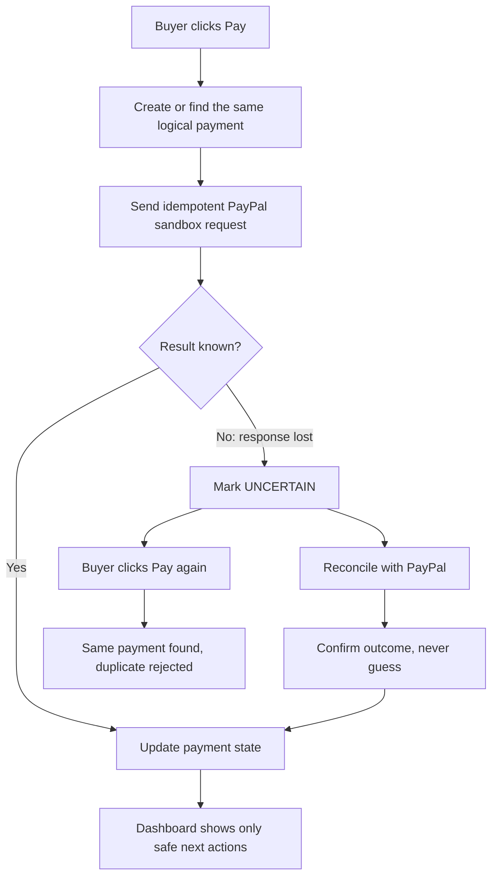
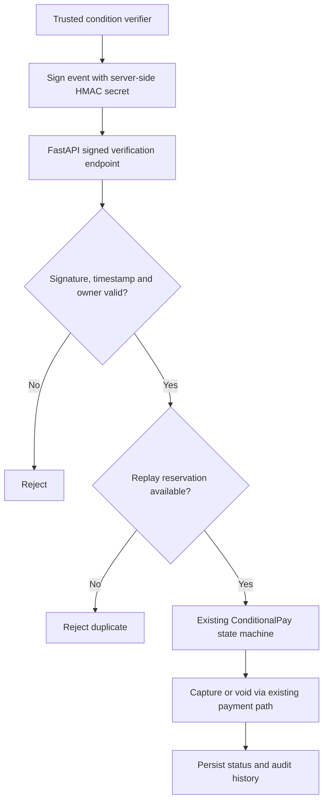
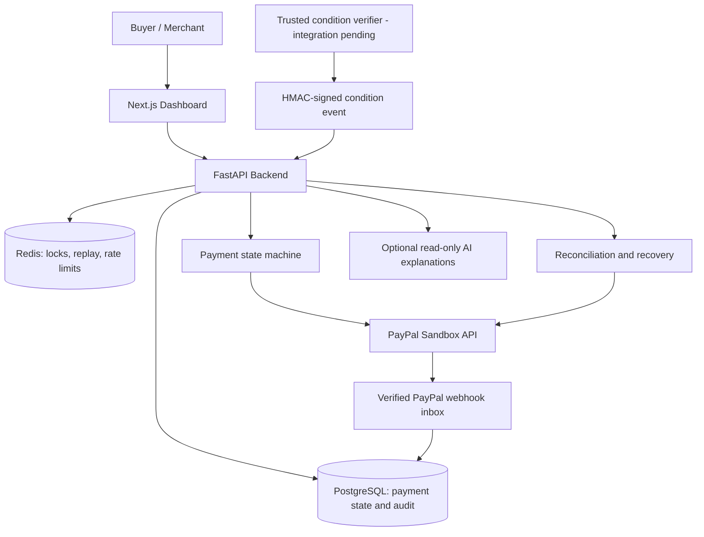

<h1>🦥 SlothPay</h1>

<p></p>
  <b>The payment-safety layer that helps a payment survive a lost answer.</b>
</p>

<p>
  <i>A payment should never happen twice because a response arrived once too late.</i>
</p>

<p>
  <a href="https://github.com/agcodes0315/SlothPay"></a>
  <a href="https://paypalaihackathon.devpost.com/"></a>
  <a href="./LICENSE"></a>
</p>

<p>
  
  
  
  
  
  
</p>

<p>
  <b>PayPal Sandbox only · No real money moves · Not for live financial transactions</b>
</p>

---

## Overview

Payment APIs are good at accepting a request. The harder problem begins **when the answer is lost**.

> **What if PayPal processed a payment, but your browser never received the confirmation?**

SlothPay preserves payment state across timeouts, retries, delayed approvals and background reconciliation. It avoids duplicate money movement, verifies uncertain outcomes and shows the user only the actions that are safe next.

**The core idea:** preserve state, reuse identifiers, reconcile uncertainty, and never guess about money.

| | |
|---|---|
| **Problem** | Payment confirmations can be lost even when the provider processed the request. Users retry, and asynchronous events arrive late or out of order. |
| **Task** | Build a PayPal-sandbox payment layer that avoids duplicate money movement, makes uncertain states recoverable and keeps a clear decision trail. |
| **Actions** | Idempotency, database state transitions, Redis locks and replay guards, reconciliation, webhook verification, state-aware recovery, a Next.js dashboard and optional read-only AI explanations. |
| **Results** | Task 18 local checks: 5/5 PostgreSQL-backed signed-webhook integration tests, 34 passing targeted security/recovery tests and clean Ruff validation. This is test evidence, not production payment-volume evidence. |

---

## Project Links

| Resource | Link |
|---|---|
| Source code | [github.com/agcodes0315/SlothPay](https://github.com/agcodes0315/SlothPay) |
| Hosted frontend | _Add the verified public URL after it is live_ |
| API health check | _Add the verified backend URL + `/health`_ |
| Video walkthrough | _Add the published demo video URL_ |
| Hackathon | [PayPal AI Hackathon 2026](https://paypalaihackathon.devpost.com/) |
| Deployment guide | [`docs/deploy.md`](./docs/deploy.md) |

> **Deployment note:** The example Render URLs in the repository are configuration examples, not proof of an active deployment. A free-tier backend may need time to wake up. Never publish sandbox credentials or expose local test-signing helpers.

---

## How It Works

When a buyer clicks **Pay** on a slow connection and the response is lost, SlothPay does not guess and does not retry the money move.



> **Design rule:** AI explains; the deterministic state machine decides what may happen to money.

---

## Features

| Capability | What it does |
|---|---|
| 💳 **SmartPay** | Safer pay-now workflow using idempotency and recovery after lost responses. |
| ⏳ **ConditionalPay** | Authorize first; capture when a verified condition is met, or void when it is not. Silence never authorizes capture. |
| 🔁 **Duplicate protection** | Idempotency keys, a Redis lock, open-payment checks and database claims stop races from becoming repeated payment actions. |
| 🧭 **Reconciliation** | Ambiguous outcomes are marked `UNCERTAIN`, then checked against provider state instead of being retried. |
| 🛟 **Rescue actions** | Only actions allowed by the current payment state are offered. |
| 🛡️ **Trust Passport** | Signed, shareable payment-history summaries for auditability. |
| 📡 **Live updates** | Payment state and safety indicators on the dashboard. |
| 🧪 **Failure simulation** | Sandbox-only scenarios such as dropped responses, delays and concurrent clicks. |
| 🤖 **Optional AI assistance** | Explains masked payment details and helps draft invoice data. It never decides payments. |
| ⏱️ **Speed and comparison (Task 19)** | Payment timing instrumentation, benchmarks and a `/compare` dashboard. Availability depends on whether that PR is merged and deployed. |

---

## Duplicate Protection

A repeated click, a retried request and a concurrent request must all resolve to **one** logical payment action.

| Layer | Role |
|---|---|
| Idempotency key | Stable identifier reused for the same logical payment |
| Open-payment check | Finds an in-flight payment before creating another |
| Redis lock | Serializes concurrent attempts |
| Database claim | Records which attempt owns the payment action |

---

## Task 18: Signed Conditional Verification

A third-party signal must not trigger capture just because it says `verified: true`. Task 18 adds an authenticated, replay-resistant boundary to the existing ConditionalPay capture/void path.

**Endpoint:** `POST /api/extensions/zapier/verify`



| Control | What it protects |
|---|---|
| HMAC-SHA256 over timestamp, event ID and exact body bytes | Rejects events not signed by the server-side secret, and modified bodies |
| Constant-time signature comparison | Avoids timing-sensitive comparison behavior |
| Five-minute timestamp window | Rejects stale deliveries |
| Ownership from the signed body | Prevents the owner being swapped through an unsigned query parameter |
| Atomic Redis event reservation (seven days) | Rejects duplicate or replayed events |
| Existing state machine and PayPal path | One capture/void implementation and one audit path |

> **Important distinction:** This is a **custom SlothPay signature**, not a native Zapier webhook signature. A real Zapier automation still needs a trusted event source and an independently validated condition before a server holding the signing secret can authorize an action. The repository's local signing relay is synthetic-only and must never be exposed publicly for real payment authorization.

The reviewer-requested documentation, BOM cleanup and router-comment correction were merged in a follow-up to the Task 18 feature PR.

---

## Architecture



For details see [`docs/architecture.md`](./docs/architecture.md) and [`docs/state-machine-contract.md`](./docs/state-machine-contract.md).

---

## Quick Start

**Requirements:** Docker Desktop with Docker Compose, Python 3.12, Node.js 20+, Git, and a PayPal developer sandbox application with a sandbox buyer account.

### 1. Prepare the backend

```bash
git clone https://github.com/agcodes0315/SlothPay.git
cd SlothPay
cp .env.example .env
```

Edit `.env` and set `PAYPAL_CLIENT_ID`, `PAYPAL_CLIENT_SECRET` and the required secrets, using **sandbox-only** credentials. Generate random signing secrets with:

```bash
python -c "import secrets; print(secrets.token_urlsafe(48))"
```

Use distinct secrets for `ADMIN_API_KEY`, `PASSPORT_SIGNING_SECRET` and, where condition webhooks are enabled, `CONDITION_WEBHOOK_SECRET`. Never commit real values.

### 2. Start the services

```bash
docker compose up -d --build
```

The API runs at [http://localhost:8000](http://localhost:8000) and the health check at [http://localhost:8000/health](http://localhost:8000/health).

To also start the recovery and webhook worker containers, where supported locally:

```bash
docker compose --profile workers up -d --build
```

### 3. Start the dashboard

In a second terminal:

```bash
cd frontend
cp .env.example .env.local
npm install
npm run dev
```

Open [http://localhost:3000](http://localhost:3000).

<details>
<summary><b>Windows PowerShell notes</b></summary>

<br>

Replace `cp` with `Copy-Item` or `copy`. To run tests from the repository root:

```powershell
python -m venv .venv
.\.venv\Scripts\Activate.ps1
python -m pip install -r requirements.txt -r requirements-dev.txt
$env:SLOTHPAY_RUN_DB_TESTS = "1"
.\.venv\Scripts\python.exe -m pytest -q -rs tests/unit tests/integration
```

The PostgreSQL integration fixtures create and remove isolated local databases. They refuse to run against remote database hosts.

</details>

---

## Try a PayPal Sandbox Payment

1. Open the [PayPal Developer Dashboard](https://developer.paypal.com/) and find your **Sandbox** accounts.
2. Use a sandbox personal/buyer account, **not** your real PayPal login.
3. In SlothPay, create a small **SmartPay** payment and follow the PayPal sandbox approval redirect.
4. Approve with the sandbox buyer account, return to SlothPay and check the resulting status.
5. For **ConditionalPay**, create and approve an authorization, then test the permitted capture/void path under the verification rules.

> The local fake-PayPal simulator used by automated tests is **not** an actual PayPal sandbox transaction. Manual sandbox approval and a working webhook callback are separate end-to-end validations.

---

## Testing

```bash
# Unit tests
python -m pytest -q tests/unit

# Integration tests (isolated local PostgreSQL only)
export SLOTHPAY_RUN_DB_TESTS=1   # macOS / Linux
python -m pytest -q -rs tests/integration
```

<details>
<summary><b>Focused Task 18 tests, lint, secret scan and frontend checks</b></summary>

<br>

```bash
# Focused Task 18 tests
python -m pytest -q tests/unit/test_replay_guard.py tests/unit/test_signed_conditions.py tests/integration/test_task18_webhook_flow.py

# Lint and secret scan
python -m ruff check backend tests scripts database
python scripts/scan_secrets.py

# Frontend
cd frontend
npm run lint
npm run build
```

</details>

<details>
<summary><b>Failure cases worth testing</b></summary>

<br>

- duplicated clicks
- duplicate signed events
- bad signatures
- wrong owner
- stale timestamps
- lost PayPal response
- concurrent state transitions
- capture failure
- recovery after ambiguity

</details>

### Verified results

| Check | Status |
|---|---|
| Task 18 PostgreSQL-backed webhook integration | **5 passed** (reported local run) |
| Targeted payment security and recovery regression | **34 passed** (reported local run) |
| Task 18 Ruff validation | **Passed** (reported local run) |
| Broader suite | 1,179 passed, 24 skipped (Temporal), 1 xfailed (reviewer-reported, not independently re-run for this README) |
| Task 19 selected backend tests | 171 passed across selected suites (previously reported) |
| Task 19 frontend production build | Successful on its isolated branch (previously reported) |
| Real external Zapier → verifier → PayPal sandbox | **Not yet end-to-end verified** |

> These are engineering test results from local and reviewed runs. They are not a claim of production payment volume or live uptime.

---

## How AI Is Used

**Gemma** is an optional advisory layer for plain-language payment explanations and invoice drafting, when configured.

- It works on **masked** facts.
- It returns structured suggestions constrained to allowed state-machine actions.
- It does **not** decide, capture or void payments.
- Without a model configuration, the application falls back to fixed text.

Claude was also used as a development assistant for drafting and reviewing code, tests and documentation.

---

## Real vs Simulated

| Real implementation | Sandbox, simulated or not yet verified |
|---|---|
| FastAPI routes and persisted payment state | Sandbox PayPal transactions move no real money |
| Signed event validation and Redis replay control | Synthetic signed-event tests are not a native Zapier integration |
| PayPal sandbox client and webhook verification code | Real sandbox buyer approval needs a separate manual end-to-end run |
| Reconciliation and state-aware recovery logic | Stress tests use a fake PayPal simulator |
| Signed Trust Passport and dashboard | Optional AI explanations may use a deterministic fallback |
| Test and local deployment configuration | Public production readiness and live uptime are not claimed |

---

## Security and Known Limitations

**Current controls:** HMAC-signed condition events, constant-time comparison, five-minute timestamp window, signed-body ownership, atomic Redis replay reservation, idempotency keys with Redis lock and database claims, verified PayPal webhook inbox, state-transition validation, masked data for optional AI, secret scanning (`scripts/scan_secrets.py`) and audit history.

See [`docs/TASK16_SECURITY.md`](./docs/TASK16_SECURITY.md) for security controls and deployment caveats.

**Known limitations:**

- Do not use this hackathon system for live financial transactions.
- A lost response during order creation may be impossible to reconcile if no provider order identifier exists.
- A failed signed-event processing attempt can keep its seven-day replay reservation. Investigate uncertain outcomes before any reset.
- The signed verification route needs its own explicit rate-limit policy before broad public exposure.
- Free hosting and optional Temporal/background workers have operational limits; see [`docs/deploy.md`](./docs/deploy.md).
- The documented capture-decline handling includes an expected-failure test and should not be described as fully resolved.

**SlothPay does not claim:** real money movement, a native Zapier webhook signature, a verified real Zapier → verifier → PayPal sandbox flow, a verified public deployment or live uptime, production-scale payment volume, or completed manual PayPal sandbox and webhook end-to-end validation.

---

## Deployment

The repository includes [`render.yaml`](./render.yaml) and a full guide in [`docs/deploy.md`](./docs/deploy.md).

Typical setup: a Docker-based backend on Render, a Next.js frontend on Render or Vercel, and managed PostgreSQL and Redis. Check current free-tier availability and persistence before deploying a judge-facing demo. Configure the real frontend origin, public backend URL, HTTPS webhooks and PayPal sandbox variables through provider secrets.

> Do not publish a URL in this README until the service actually responds. Keep the seven-day replay store persistent if you make security guarantees across server restarts.

---

## Roadmap

- [x] SmartPay and ConditionalPay core workflows
- [x] Lost-answer handling and reconciliation logic
- [x] Signed verification with replay protection (Task 18)
- [x] Task 18 feature PR and reviewer cleanup merged
- [ ] Confirm Task 19 PR merge and release the timing/comparison dashboard
- [ ] Verify live frontend + backend + database + Redis deployment
- [ ] Complete manual PayPal sandbox transaction and webhook end-to-end validation
- [ ] Connect a real, independently verified Zapier-origin condition through a trusted signer
- [ ] Add route-specific rate limiting and an audited replay-reservation recovery policy
- [ ] Publish a demo video and verified public URLs

---

## Pitch

**10 seconds:** SlothPay is the safety layer for payments whose confirmation gets lost. It keeps a durable payment state, reuses stable identifiers, rejects duplicates and reconciles uncertain outcomes with PayPal.

**20 seconds:** Most payment integrations assume the response arrives. In reality connections drop, users click again and events arrive late or twice. SlothPay marks ambiguous outcomes `UNCERTAIN`, checks PayPal instead of retrying the money move, and only captures a conditional payment when a signed, fresh, owner-matched, never-seen-before event arrives. AI can explain what happened, but the deterministic state machine decides what may happen to money.

---

## Repository Structure

```text
SlothPay/
├── backend/                 FastAPI backend: state machine, PayPal client, webhooks, recovery
├── database/                PostgreSQL schema and helpers
├── frontend/                Next.js dashboard
├── scripts/
│   └── scan_secrets.py      Secret scanner
├── tests/
│   ├── unit/                Unit and regression tests
│   └── integration/         PostgreSQL-backed integration tests
├── docs/                    Architecture, state machine, deployment, demo script, security
├── docker-compose.yml       Local services (profile: workers)
├── render.yaml              Render deployment example
├── requirements.txt
├── requirements-dev.txt
├── .env.example
├── LICENSE
└── README.md
```

> Adjust the folder comments if your actual layout differs.

## Documentation

| Document | Purpose |
|---|---|
| [`docs/architecture.md`](./docs/architecture.md) | System components and payment paths |
| [`docs/state-machine-contract.md`](./docs/state-machine-contract.md) | Valid payment state transitions |
| [`docs/deploy.md`](./docs/deploy.md) | Hosting, secrets and PayPal sandbox configuration |
| [`docs/demo-script.md`](./docs/demo-script.md) | Three-minute hackathon demonstration |
| [`docs/TASK16_SECURITY.md`](./docs/TASK16_SECURITY.md) | Security controls and deployment caveats |
| [`tests/integration/test_task18_webhook_flow.py`](./tests/integration/test_task18_webhook_flow.py) | Signed webhook capture/void/replay tests |

---

## Team

<table>
<tr>
<td align="center" width="50%">
<a href="https://github.com/agcodes0315"></a>
<br><b>Agrima Saxena</b><br>
<sub>Backend security · Task 18 signed conditions · testing, review and integration</sub>
<br><br>
<a href="https://github.com/agcodes0315"></a>
<a href="https://www.linkedin.com/in/agrima-saxena-142960426/"></a>
<a href="mailto:agrimalc@gmail.com"></a>
</td>
<td align="center" width="50%">
<a href="https://github.com/Ayush-23479"></a>
<br><b>Ayush Verma</b><br>
<sub>Task 19 payment timing · comparison dashboard · backend instrumentation and tests</sub>
<br><br>
<a href="https://github.com/Ayush-23479"></a>
<a href="https://www.linkedin.com/in/ayush-verma-1112a0260/"></a>
<a href="mailto:ayushverma19171051@gmail.com"></a>
</td>
</tr>
</table>

---

## License

Released under the [MIT License](./LICENSE).

<p align="center">
  🦥 <b>Pay once. Know what happened. Recover safely.</b><br>
  <sub>Built with care for the PayPal AI Hackathon 2026.</sub>
</p>
