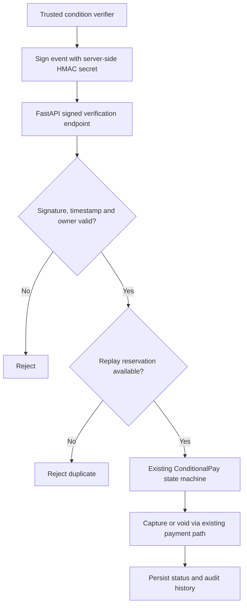

🦥 SlothPay
AI-Assisted Payment Safety, Conditional Payments & Failure Recovery
A payment should never happen twice because a response arrived once too late.
What if PayPal processed a payment, but your browser never received the confirmation?
SlothPay is built for that uncomfortable moment: preserve the payment state, avoid duplicate money movement, verify uncertain outcomes, and show the user what is safe to do next.

Built for the PayPal AI Hackathon 2026 · PayPal Sandbox only · No real money moves

  
  
  

  
  
  
  
  
  

🌐 Live Demo & Project Links
Resource	Link / Availability
📦 Source code	github.com/agcodes0315/SlothPay
🌐 Hosted frontend	Add the verified public deployment URL after it is live
🔗 API health check	Add the verified backend URL + /health
📽️ Video walkthrough	Add the published demo video URL
🏆 Hackathon	PayPal AI Hackathon 2026
🛠️ Deployment guide	[`docs/deploy.md`](./docs/deploy.md)

Deployment note: The repository's example Render URLs are configuration examples, not proof of an active deployment. A free-tier backend may need time to wake up. Do not publish sandbox credentials or expose local test-signing helpers.

🎯 The Problem — When a Payment Succeeds but the Answer Fails
Picture a buyer checking out on a slow connection:
1. They click Pay.
2. PayPal receives or processes the request.
3. The connection fails before the buyer receives the response.
4. The buyer clicks Pay again, unsure whether the first attempt succeeded.
5. The platform must avoid charging twice without guessing what happened.
The difficult part is not just making a PayPal API call. It is keeping the entire workflow safe across timeouts, retries, concurrent requests, delayed approvals, background reconciliation and changing payment states.

SlothPay's approach: preserve a durable state, reuse stable request identifiers, reject duplicate operations, reconcile uncertain outcomes against PayPal and surface permitted next actions.
Buyer clicks Pay
       |
       v
Create or find the same logical payment
       |
       v
Send idempotent PayPal sandbox request
       |
       +---- Known result ----------> Update payment state
       |
       +---- Lost response ---------> UNCERTAIN
                                         |
                                         v
                                   Reconcile with PayPal
                                         |
                                         v
                             Confirm outcome; never guess
⚡ Problem → Task → Action → Result
STAR element	Engineering story
Situation	Payment confirmations can get lost even when a provider processes the request; users retry and asynchronous events arrive out of order.
Task	Build a PayPal-sandbox payment layer that avoids duplicate money movements, makes uncertain states recoverable and preserves a clear decision trail.
Action	Combine idempotency, database state transitions, Redis locks and replay guards, reconciliation, webhook verification, state-aware recovery, a Next.js dashboard and optional read-only AI explanations.
Result	Verified local Task 18 checks: 5/5 PostgreSQL-backed signed-webhook integration tests and 34 passing targeted security/recovery tests, plus clean Ruff validation in the reported run. This is test evidence, not production payment-volume evidence.

🧩 What SlothPay Does
Capability	How it helps
💳 SmartPay	Safer pay-now workflow using idempotency and recovery after lost responses.
⏳ ConditionalPay	Authorize first; capture when a verified condition is met, or void when it is not. Silence never authorizes capture.
🔁 Duplicate protection	Idempotency keys, a Redis lock, open-payment checks and database claims prevent races from becoming repeated payment actions.
🧭 Uncertain-outcome reconciliation	Mark ambiguous outcomes UNCERTAIN, then check provider state rather than immediately retrying a money move.
🛟 Rescue actions	Present only actions allowed by the current payment state.
🛡️ Trust Passport	Signed, shareable payment-history summaries for auditability and trust.
📡 Live updates	Track payment state and safety indicators through the dashboard.
🧪 Failure simulation	Sandbox-only chaos scenarios such as dropped responses, delays and concurrent clicks.
🤖 Optional AI assistance	Explain masked payment details and help draft invoice data; deterministic rules control payment decisions.
⏱️ Speed & comparison (Task 19)	Payment timing instrumentation, benchmarks and /compare dashboard in the Task 19 implementation; availability depends on whether that PR has been merged/deployed.

🛡️ Task 18 — Signed Conditional Verification
A third-party signal must not cause payment capture merely because it says verified: true. SlothPay's Task 18 adds an authenticated, replay-resistant boundary to its existing ConditionalPay capture/void path.

Controls implemented:
- HMAC-SHA256 over the timestamp, event identifier and exact request-body bytes.
- Constant-time signature comparison to avoid timing-sensitive comparison behavior.
- Five-minute timestamp acceptance window to reject stale deliveries.
- Ownership derived from the signed request body, not an unsigned query parameter.
- Atomic Redis event reservation with a seven-day replay window.
- Existing payment state transitions and PayPal path reused, rather than introducing a second capture implementation.
Endpoint: POST /api/extensions/zapier/verify

Important distinction: This is a custom SlothPay signature, not a native Zapier webhook signature. A real Zapier automation still requires a trusted event source and an independently validated condition before a server holding the signing secret can authorize an action. The repository's local signing relay is synthetic-only and must never be exposed publicly for real payment authorization.

The reviewer-requested documentation, BOM cleanup and router-comment correction were merged in a follow-up to the Task 18 feature PR.
🏗️ Architecture

Design rule: AI explains; the deterministic state machine decides what may happen to money.

For implementation details see [`docs/architecture.md`](./docs/architecture.md) and [`docs/state-machine-contract.md`](./docs/state-machine-contract.md).
🚀 Quick Start
Prerequisites
- Docker Desktop and Docker Compose
- Python 3.12 and Node.js 20+
- A PayPal developer sandbox application and sandbox buyer account
- Git
1. Prepare the backend
git clone https://github.com/agcodes0315/SlothPay.git
cd SlothPay
cp .env.example .env
Edit .env and configure PAYPAL_CLIENT_ID, PAYPAL_CLIENT_SECRET and required secrets using sandbox-only credentials. Generate random signing secrets with:
python -c "import secrets; print(secrets.token_urlsafe(48))"
Use distinct secrets for the relevant settings (ADMIN_API_KEY, PASSPORT_SIGNING_SECRET, and CONDITION_WEBHOOK_SECRET where condition webhooks are enabled). Never commit actual values.
2. Start the local services
docker compose up -d --build
API: http://localhost:8000 · Health: http://localhost:8000/health

For dedicated recovery/webhook worker containers when supported locally:
docker compose --profile workers up -d --build
3. Start the frontend
cd frontend
cp .env.example .env.local
npm install
npm run dev
Open http://localhost:3000.

<b>🪟 Windows PowerShell notes</b>

Replace cp with Copy-Item or copy. To run tests from the repository root:
python -m venv .venv
.\.venv\Scripts\Activate.ps1
python -m pip install -r requirements.txt -r requirements-dev.txt
$env:SLOTHPAY_RUN_DB_TESTS = "1"
.\.venv\Scripts\python.exe -m pytest -q -rs tests/unit tests/integration
The PostgreSQL integration fixtures create and remove isolated local databases. They refuse to run against remote database hosts.

💳 Try a PayPal Sandbox Payment
1. Visit the PayPal Developer Dashboard and locate your Sandbox accounts.
2. Use a sandbox personal/buyer account, not your real PayPal login.
3. In SlothPay, create a small SmartPay payment and follow the PayPal sandbox approval redirect.
4. Approve using the sandbox buyer account, return to SlothPay and inspect the resulting status.
5. For ConditionalPay, create and approve an authorization and test the permitted capture/void path under the relevant verification rules.
The local fake-PayPal simulator used by automated tests is not an actual PayPal sandbox transaction. Manual sandbox approval and a working webhook callback are separate end-to-end validations.

🧪 Testing & Engineering Evidence
Check	Verified / documented status
Task 18 PostgreSQL-backed webhook integration	5 passed in the reported local run
Targeted payment security and recovery regression	34 passed in the reported local run
Task 18 Ruff validation	Passed in the reported local run
Broader suite	Reviewer reported 1,179 passed, 24 skipped (Temporal), 1 xfailed; not independently re-run for this README
Task 19 selected backend tests	Previously reported 171 passed across selected suites
Task 19 frontend production build	Previously reported successful on its isolated branch
Real external Zapier → verifier → PayPal sandbox	Not yet end-to-end verified

# Unit tests
python -m pytest -q tests/unit

# Enable isolated PostgreSQL integration tests (local database only)
# macOS / Linux:
export SLOTHPAY_RUN_DB_TESTS=1
python -m pytest -q -rs tests/integration

# Focused Task 18 tests
python -m pytest -q tests/unit/test_replay_guard.py tests/unit/test_signed_conditions.py tests/integration/test_task18_webhook_flow.py

# Lint and secret scan
python -m ruff check backend tests scripts database
python scripts/scan_secrets.py
For the frontend:
cd frontend
npm run lint
npm run build
Failure cases worth testing: duplicated clicks, duplicate signed events, bad signatures, wrong owner, stale timestamps, lost PayPal response, concurrent state transitions, capture failure and recovery after ambiguity.
🤖 How AI Is Used
Gemma is an optional advisory layer used for plain-language payment explanations and invoice drafting when configured. It operates on masked facts and produces structured suggestions constrained by allowed state-machine actions. It does not decide, capture or void payments. Without a model configuration, the application falls back to fixed text.

The source README also describes Claude as a development assistant for drafting/reviewing code, tests and documentation. Include additional models or tools in a hackathon submission only if your team actually used them.
🔐 Security & Real-vs-Simulated Boundaries
Real implementation	Sandbox / simulated / not yet verified
FastAPI routes and persisted payment state	Sandbox PayPal transactions move no real money
Signed event validation and Redis replay control	Synthetic signed-event tests are not native Zapier integration
PayPal sandbox client and webhook verification code	Real sandbox buyer approval requires a separate manual E2E run
Reconciliation and state-aware recovery logic	Stress tests use a fake PayPal simulator
Signed Trust Passport and dashboard	Optional AI explanations may use a deterministic fallback
Test and local deployment configuration	Public production-readiness and live uptime are not claimed

Known limitations:
- Do not use this hackathon system for live financial transactions.
- A lost response during order creation may be impossible to reconcile if no provider order identifier exists.
- A failed signed-event processing attempt can retain its seven-day replay reservation; investigate uncertain outcomes before any reset.
- The signed verification route needs its own explicit rate-limit policy before broad public exposure.
- Free hosting and optional Temporal/background workers have operational limitations; consult [`docs/deploy.md`](./docs/deploy.md).
- The documented capture-decline handling includes an expected-failure test; it should not be described as fully resolved.
☁️ Deployment
The repository contains [`render.yaml`](./render.yaml) and a full [`docs/deploy.md`](./docs/deploy.md) deployment guide.

Typical options include a Docker-based backend on Render, a Next.js frontend on Render/Vercel, and managed PostgreSQL/Redis. Check current free-tier availability and persistence before deploying a judge-facing demo. Configure the real frontend origin, the public backend URL, HTTPS webhooks and PayPal sandbox environment variables through provider secrets.

Do not publish a URL in this README until the actual service responds successfully. Keep the seven-day replay store persistent if making security guarantees across server restarts.
🗺️ Roadmap
- [x] SmartPay and ConditionalPay core workflows (repository implementation)
- [x] Lost-answer handling and reconciliation logic
- [x] Signed verification with replay protection (Task 18)
- [x] Task 18 feature PR and reviewer cleanup merged
- [ ] Confirm Task 19 PR merge and release the timing/comparison dashboard
- [ ] Verify live frontend + backend + database + Redis deployment
- [ ] Complete manual PayPal sandbox transaction and webhook E2E validation
- [ ] Connect a real, independently verified Zapier-origin condition through a trusted signer
- [ ] Add route-specific rate limiting and audited replay-reservation recovery policy
- [ ] Publish a judge-friendly demo video and verified public URLs
📚 Documentation
Document	Purpose
[`docs/architecture.md`](./docs/architecture.md)	System components and payment paths
[`docs/state-machine-contract.md`](./docs/state-machine-contract.md)	Valid payment state transitions
[`docs/deploy.md`](./docs/deploy.md)	Hosting, secrets and PayPal sandbox configuration
[`docs/demo-script.md`](./docs/demo-script.md)	Three-minute hackathon demonstration
[`docs/TASK16_SECURITY.md`](./docs/TASK16_SECURITY.md)	Security controls and deployment caveats
[`tests/integration/test_task18_webhook_flow.py`](./tests/integration/test_task18_webhook_flow.py)	Signed webhook capture/void/replay tests

👥 Contributors
<table>
<tr>
<td align="center" width="50%">

 <b>Agrima Saxena</b> 
Backend security · Task 18 signed conditions · testing, review & integration
  

</td>
<td align="center" width="50%">

 <b>Ayush Verma</b> 
Task 19 payment timing · comparison dashboard · backend instrumentation & tests
  

</td>
</tr>
</table>

📄 License
Released under the MIT License. See the repository license for full terms.

🦥 Pay once. Know what happened. Recover safely.
Built with care for the PayPal AI Hackathon 2026.

⬆ Back to top

