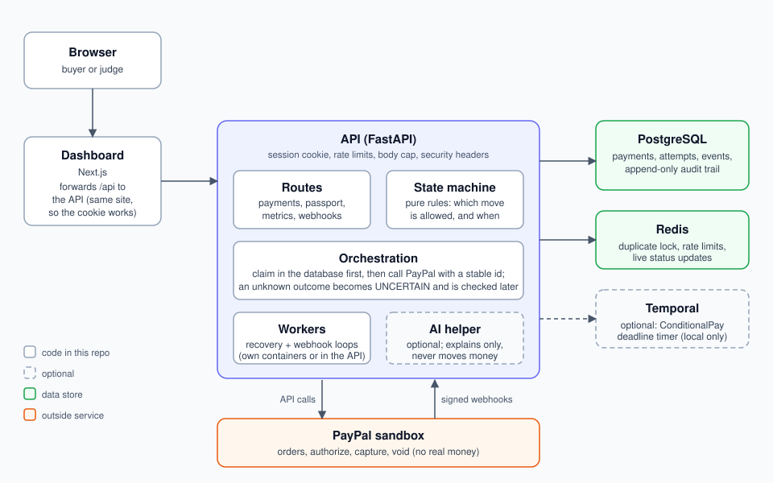

# SlothPay

**A payment-safety layer for PayPal: no double charges, no guessing when an answer is lost, and a
clear record of what really happened.** Built for the PayPal hackathon. **Sandbox only: no real
money ever moves.**

> **Try it:** hosted demo at `https://slothpay-web.onrender.com` (the first load after a quiet
> period can take about a minute while the free host wakes up). Use the PayPal sandbox buyer
> account described in [How to log in as the sandbox buyer](#how-to-log-in-as-the-sandbox-buyer).
> *(Replace this link with the real address after deploying: see `docs/deploy.md`.)*

## The problem

A buyer taps Pay on a slow connection. PayPal takes the money, but the answer is lost on the way
back. The buyer sees an error and taps Pay again. Now there are two charges, or money sits frozen
between them, or a merchant ships against a payment nobody confirmed.

SlothPay sits between the checkout and PayPal and makes three promises:

1. **A money move never happens twice.** A repeated tap or a retry finds the same payment.
2. **Nothing is guessed.** If an answer is lost, the payment is marked uncertain and SlothPay asks
   PayPal what happened instead of charging again.
3. **The truth is visible.** Buyer and merchant see a plain status, the one safe next step, and a
   tamper-proof history.

## What it does

- **SmartPay.** Pay now, safe against double clicks, retries and lost answers.
- **ConditionalPay.** The buyer's funds are held (authorized). The owner marks the condition met
  (the funds are captured) or not met (the hold is voided). Silence never captures.
- **Duplicate protection.** Idempotency keys, a lock, an open-payment check, stable PayPal request
  ids, and a database claim so two racing requests cannot both move money.
- **Lost-answer recovery.** An unknown outcome becomes `UNCERTAIN` and is checked against PayPal
  at growing delays until the real state is known.
- **Rescue.** For a payment that needs a person, the dashboard offers only the actions that are
  safe for its current state.
- **Trust Passport.** A shareable, signed summary of what happened to a payment.
- **Live dashboard.** Statuses update as they change; the safety numbers show payments, checks in
  progress, recoveries and duplicates stopped.
- **Webhooks.** PayPal's signed events are verified, stored once and applied.
- **Break it on purpose.** A sandbox-only panel that drops an answer, slows PayPal down or runs a
  double-click test, so you can watch SlothPay recover.
- **Optional AI explanations.** Plain-language help that only reads masked facts and never moves
  money. Without a model configured, fixed text is used.
- **Security.** Signed session cookies, rate limits, a request size cap, security headers, and
  refusal to start with an unsafe configuration in demo or production.

## Architecture



The layers, the two payment paths, the status model, how duplicates are stopped and how a lost
answer is recovered are explained in [`docs/architecture.md`](docs/architecture.md). The rules for
the state machine are in [`docs/state-machine-contract.md`](docs/state-machine-contract.md).

## What is real and what is simulated

| Part | Real or simulated |
| --- | --- |
| PayPal calls from the dashboard and the hosted demo | **Real PayPal sandbox.** Test accounts only; no real money. |
| `tests/fake_paypal` and `scripts/stress_fake.py` | **A local simulator** that mimics the few PayPal endpoints SlothPay uses. It exists only for bulk stress tests and the Task 15 scenarios. Every number it produces says so. |
| Timings in the Safety numbers | **Sandbox timings.** Real PayPal will differ. |
| The AI explanations | Real model output when configured, otherwise fixed text. |

The fake PayPal shows that SlothPay's own logic does not duplicate payments. It says nothing about
real PayPal. The only test that reports real sandbox behaviour is the manual one (see
[How to run the tests](#how-to-run-the-tests)), and it needs a person to approve the payment.

## Quick start (Docker Compose)

You need Docker Desktop, Node.js 20 or newer (for the dashboard) and a PayPal **Sandbox** app
(developer.paypal.com, Apps & Credentials, Sandbox).

```bash
# 1. Settings
cp .env.example .env
#    Open .env and set PAYPAL_CLIENT_ID and PAYPAL_CLIENT_SECRET (sandbox values).
#    Set ADMIN_API_KEY and PASSPORT_SIGNING_SECRET to random strings of 32+ characters:
python3 -c "import secrets; print(secrets.token_urlsafe(48))"

# 2. Database, Redis, Temporal, migrations and the API (http://localhost:8000)
docker compose up -d --build

# 3. The dashboard (http://localhost:3000)
cd frontend
cp .env.example .env.local
npm install
npm run dev
```

Open http://localhost:3000. If the page shows "connection refused" messages, the API is not
running: check `docker compose ps`.

**With the background workers.** The recovery worker (checks uncertain payments) and the webhook
worker (applies PayPal events) run as extra containers:

```bash
docker compose --profile workers up -d --build
```

**Break-it-on-purpose panel.** In `.env` set `CHAOS_ENABLED=true`, then put the same value as
`ADMIN_API_KEY` into `frontend/.env.local` as `NEXT_PUBLIC_ADMIN_API_KEY`, and restart. The panel
appears on the dashboard. Without it the dashboard logs one harmless `404` for `/api/chaos`.

**Windows.** Use `copy .env.example .env` and `python` instead of `cp` and `python3`. Everything
else is the same.

## How to log in as the sandbox buyer

PayPal creates sandbox test accounts for you. They are not real people and hold no real money.

1. Go to developer.paypal.com, **Testing tools**, **Sandbox accounts**.
2. Open the **Personal** (buyer) account. Its email and password are shown there.
3. In the dashboard, create a SmartPay payment of a small amount and press **Create payment**.
4. When PayPal's page opens, sign in with that **sandbox buyer** email and password and approve.
5. You return to the dashboard and the payment completes.

Never use a real PayPal account. Never paste real or sandbox secrets into an issue or a pull
request.

## How to run the demo

The 3-minute script is in [`docs/demo-script.md`](docs/demo-script.md): the frozen-money story,
SmartPay, ConditionalPay with a verified condition, lost-answer recovery with the chaos panel, the
double-click test and the Trust Passport.

## Environment

Backend settings (`.env`, read by `backend/config/settings.py`):

| Variable | Default | Meaning |
| --- | --- | --- |
| `ENV` | `local` | `local`, `sandbox`, `demo` or `production`. `demo` and `production` enforce the safety guards. |
| `DATABASE_URL` | local PostgreSQL | `postgresql+asyncpg://...`. A plain `postgres://` or `postgresql://` URL from a host is accepted too. |
| `REDIS_URL` | `redis://localhost:6379/0` | Duplicate lock, rate limits and live updates. |
| `PAYPAL_CLIENT_ID`, `PAYPAL_CLIENT_SECRET` | empty | Sandbox app credentials. |
| `PAYPAL_BASE_URL` | PayPal sandbox | Must be the sandbox. The client refuses any other address. |
| `PAYPAL_WEBHOOK_ID` | empty | Needed to verify webhooks. Without it every webhook is rejected. |
| `FRONTEND_ORIGIN` | `http://localhost:3000` | Where PayPal sends the buyer back; also the one allowed CORS origin. |
| `PASSPORT_SIGNING_SECRET` | empty | Signs share links and session cookies. 32+ random characters in demo and production. |
| `ADMIN_API_KEY` | empty | Protects the chaos controls. 32+ random characters in demo and production. |
| `CHAOS_ENABLED` | `false` | Controlled failures. Refused in demo and production. |
| `SESSION_TTL_HOURS` | `12` | Life of the session cookie. |
| `DEMO_USERS` | `alice,bob,carol` | Named identities the demo login may issue. |
| `RATE_LIMIT_PAYMENTS_PER_MINUTE` | `30` | Per client address. |
| `RATE_LIMIT_WEBHOOK_PER_MINUTE` | `300` | Per client address. |
| `RATE_LIMIT_LOGIN_PER_MINUTE` | `20` | Per client address. |
| `MAX_REQUEST_BYTES` | `65536` | Request body cap (the webhook route allows 256 KB). |
| `CONDITION_MAX_HOURS` | `48` | Longest ConditionalPay wait. |
| `ALLOWED_CURRENCIES` | `USD,EUR,GBP,INR` | Currencies the form accepts. |
| `RECONCILIATION_DELAYS_SECONDS` | `0.3,1,2,4,8` | Delays between checks of an uncertain payment. |
| `RUN_BACKGROUND_WORKERS` | `false` | Run the recovery and webhook loops inside the API (for hosts with no workers). |
| `BACKGROUND_WORKER_INTERVAL_SECONDS` | `5` | Seconds between rounds of those loops (1 to 300). |
| `TEMPORAL_ADDRESS`, `TEMPORAL_NAMESPACE` | `localhost:7233`, `default` | Optional Temporal server for the ConditionalPay timer. |
| `SENTRY_DSN` | empty | Optional error reporting. Sensitive values are scrubbed. |
| `GEMMA_BASE_URL`, `GEMMA_API_KEY`, `GEMMA_MODEL` | empty | Optional AI model (an OpenAI-style chat endpoint). Empty means fixed text. |

Frontend settings (`frontend/.env.local`, read when the dashboard is built; visible in the
browser, so never put a secret in them):

| Variable | Meaning |
| --- | --- |
| `NEXT_PUBLIC_API_BASE_URL` | Where the browser finds the API. Empty means the same site (used when `BACKEND_URL` is set). |
| `NEXT_PUBLIC_USE_MOCKS` | `true` runs the dashboard on fake data with no API. |
| `NEXT_PUBLIC_ADMIN_API_KEY` | Only for the local chaos panel. Must equal `ADMIN_API_KEY`. |
| `BACKEND_URL` | Build-time only. When set, the dashboard forwards `/api/...` to this address. Used for hosting. |

## Deploying

[`docs/deploy.md`](docs/deploy.md) has the step-by-step guide for Render, including the PayPal
webhook events, the free-plan limits (sleep, hours, database expiry), the Temporal decision, and
how to keep the demo available until judging ends. `render.yaml` is the Blueprint.

## How to run the tests

Run from the repository root with the virtual environment active. Integration tests create and
drop their own throw-away databases, but they need a **local** PostgreSQL (and Redis for the
Compose stack). They refuse to run against a remote database.

macOS and Linux:

```bash
python3 -m venv .venv && source .venv/bin/activate
pip install -r requirements.txt -r requirements-dev.txt
docker compose up -d postgres redis
export REDIS_URL=redis://localhost:6380/0
export SLOTHPAY_RUN_DB_TESTS=1
export PASSPORT_SIGNING_SECRET=$(python -c "import secrets; print(secrets.token_urlsafe(48))")
alembic upgrade head
python -m pytest -q tests/unit tests/integration
python -m ruff check backend tests scripts database
python scripts/scan_secrets.py
```

Windows PowerShell:

```powershell
$env:SLOTHPAY_RUN_DB_TESTS = "1"
.\.venv\Scripts\python.exe -m pytest -q -rs tests/unit tests/integration
.\.venv\Scripts\python.exe -m ruff check backend tests scripts database
```

| What | Command |
| --- | --- |
| Unit tests (fast, no services) | `python -m pytest -q tests/unit` |
| One scenario file | `python -m pytest -q tests/integration/test_lost_answer.py` |
| Stress run against the fake PayPal (100 payments, **simulator**) | `python scripts/stress_fake.py` |
| Same, other seed or size | `python scripts/stress_fake.py --payments 300 --seed 7` |
| Real sandbox, a person approves the buyer step | `SLOTHPAY_RUN_SANDBOX=1 python -m pytest -s tests/e2e/test_sandbox_manual.py` |
| Check your PayPal sandbox credentials | `python scripts/check_paypal.py` |
| Frontend | `cd frontend && npm run lint && npm run build` |

**Expected result.** The suite ends with every test passing except one marked `xfail`: a declined
capture is not yet shown as "ask the buyer for a new method". It is recorded as an expected
failure in `tests/integration/test_smartpay_flow.py`. A skipped test is not a passed test:
Temporal tests are skipped unless `TEMPORAL_TEST_ADDRESS` points at a running dev server.

## Security

Run `python scripts/scan_secrets.py` before every push (it exits 1 on a hit and never prints the
secret). What is enforced, and the caveats for deploying, are in
[`docs/TASK16_SECURITY.md`](docs/TASK16_SECURITY.md). After pulling a change that adds a migration,
run `alembic upgrade head` on your local database.

## Repository layout

| Path | What is there |
| --- | --- |
| `backend/api` | HTTP routes, sessions, rate limits, request limits, security headers |
| `backend/state_machine` | The pure rules: statuses, legal moves, safe actions |
| `backend/orchestration` | Runs a money move in the safe order; recovery; the optional in-API workers |
| `backend/reliability` | Request ids, duplicate lock, reconciliation, rescue, chaos switches |
| `backend/payments` | The PayPal client (sandbox address only) |
| `backend/webhooks` | Signature check, inbox and processing of PayPal events |
| `backend/intelligence` | Optional AI explanations, masking and fixed-text fallbacks |
| `backend/notifications` | Live status updates |
| `backend/workflows` | Optional Temporal workflows |
| `backend/models`, `database` | Tables and Alembic migrations |
| `frontend` | The Next.js dashboard and its Dockerfile |
| `tests` | Unit tests, PostgreSQL integration tests, the fake PayPal, a manual sandbox test |
| `scripts` | Stress runs, PayPal checks, the secrets scan |
| `docs` | Architecture, deployment, demo script, submission text, security notes |
| `render.yaml` | Render Blueprint for the hosted demo |

## AI tools used and how

- **Claude (Anthropic).** Used as a coding assistant to write and review code, tests and
  documentation from a task plan. Every change was run against the test suite and read by a
  person before it was committed.
- **Gemma (optional, at run time).** Explains a payment or an error in plain words and reads an
  invoice into a draft. It sees only masked facts, its answer must match a fixed schema, and it
  can only name actions the state machine already allows. It never decides a money move. The app
  works without it.

*(Edit this list to match exactly what your team used.)*

## Limits you should know about

- Sandbox only. Do not use it for live payments.
- A declined capture is not yet classified as "ask the buyer for a new method" (see above).
- If the answer to *create order* is lost, there is no PayPal order to look up, so that payment can
  stay uncertain (about 1 in 10 in the simulator stress run).
- The hosted demo runs without Temporal, so a ConditionalPay deadline does not expire by itself
  there. The owner presses **Verify: condition met** or **Fail: condition not met**. See
  `docs/deploy.md`.

## License

MIT. See [`LICENSE`](LICENSE).