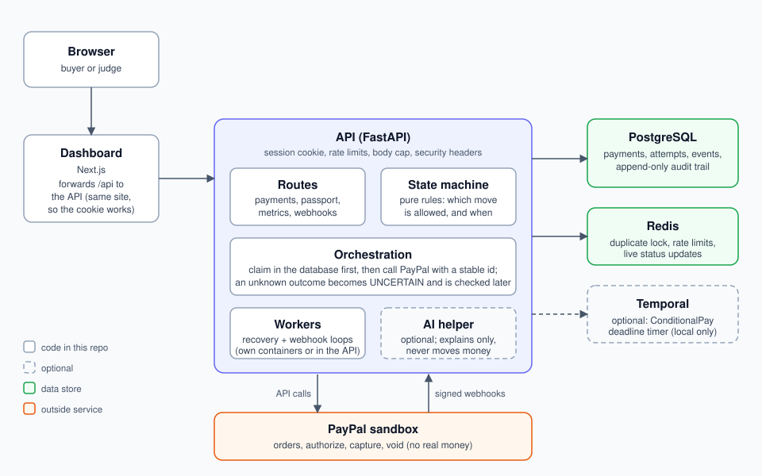

# SlothPay architecture

SlothPay is a payment-safety layer that sits between a checkout page and PayPal. It does not
replace PayPal. It makes sure a payment is never charged twice, never captured by mistake, and
never left in an unknown state without a way to resolve it. Everything runs against the **PayPal
sandbox**: no real money moves.

## The story it is built around

A buyer taps Pay on a slow connection. PayPal takes the money, but the answer is lost on the way
back. The buyer sees an error, taps Pay again, and is charged a second time. Money then sits
frozen between the two, or a merchant ships against a payment that was never confirmed.

SlothPay prevents that with three ideas:

1. **Never do a money move twice.** Every payment has a stable identity, so a repeated tap or a
   retry after a lost answer can only ever find the same payment.
2. **Never guess.** If PayPal's answer is lost, the payment is marked `UNCERTAIN` and SlothPay
   asks PayPal what happened, instead of charging again.
3. **Say what is true.** The buyer and the merchant see plain statuses and the one next step that
   is safe, and every change is written to an audit trail that cannot be edited.

## Two payment paths

| Path | What happens | Use it for |
| --- | --- | --- |
| **SmartPay** | The buyer approves in PayPal, and the payment is captured straight away. | Ordinary checkout. |
| **ConditionalPay** | The buyer approves and the funds are **authorized** (held). The owner then marks the condition as met (the funds are captured) or not met (the hold is voided). Silence never captures. | Payment that should release only after something happens, for example a delivery. |

## The layers

| Layer | Code | Its one job |
| --- | --- | --- |
| Dashboard | `frontend/` (Next.js) | Show payments, statuses, a timeline, safety numbers and the Trust Passport. |
| Routes | `backend/api` | Check the caller (signed session cookie), limit abuse, and hand work to the layers below. |
| State machine | `backend/state_machine` | Pure rules, no database and no network. Decides which status moves are legal and which actions are safe. See `docs/state-machine-contract.md`. |
| Orchestration | `backend/orchestration` | Runs a money move in the safe order: claim it in the database, then call PayPal. |
| Reliability | `backend/reliability` | Stable request ids, the duplicate lock, reconciliation, rescue plans, step timing (`timing.py`) and sandbox-only chaos switches. |
| PayPal client | `backend/payments` | The only code that talks to PayPal. It accepts only the sandbox address. One shared client keeps its connection open and renews its token in the background. |
| Webhooks | `backend/webhooks` | Verify PayPal's signature, store each event once, and apply it later. |
| Intelligence | `backend/intelligence` | Optional AI explanations. It reads masked facts and cannot move money. |
| Live updates | `backend/notifications` | Push status changes to the browser (Server-Sent Events over Redis). |
| Workflows | `backend/workflows` | Optional Temporal workflows (the ConditionalPay deadline timer). |
| Extensions | `backend/extensions` | Optional signed condition-verification webhook with replay protection (Task 18). |

## Data

PostgreSQL holds seven tables: `payments`, `payment_attempts`, `payment_reconciliations`,
`payment_conditions`, `provider_events` (the webhook inbox), `payment_audit` and
`payment_timings` (how long each step took, sandbox timings). The audit table
is append-only: the database refuses `UPDATE`, `DELETE` and `TRUNCATE` on it. Redis holds the
temporary things: the duplicate lock, the rate-limit counters and the live-update channel.

## Statuses

A payment moves through 15 internal statuses (`INTENT_CREATED` through `CAPTURED`, `VOIDED`,
`UNCERTAIN`, `FAILED` and `CANCELLED`). Four of them are final: `CAPTURED`, `VOIDED`, `FAILED` and
`CANCELLED`. The dashboard shows only four plain ones:

| Shown as | Meaning |
| --- | --- |
| Completed | The money moved and PayPal confirmed it. |
| Pending | Waiting on the buyer, on PayPal, or on a check SlothPay is running. |
| Action needed | A person must do something. The payment says what. |
| Closed | It ended without a charge: cancelled, voided or failed. |

The safe next steps come from the state machine, never from the AI. They are `WAIT`,
`RECONCILE`, `ASK_BUYER_TO_APPROVE`, `RETRY_SAME_REQUEST`, `CAPTURE`, `VOID`,
`ASK_BUYER_NEW_METHOD`, `CONTACT_SUPPORT` and `NONE`.

## How a duplicate is stopped

Several layers, so one failing does not cause a double charge:

1. **Idempotency-Key.** The same key replays the stored result instead of starting again.
2. **A lock on the key.** A second request with the same key while the first is still running gets
   `409 intent_busy` with a `Retry-After`, instead of starting a second payment.
3. **Open-intent check.** The same amount from the same owner within 2 minutes, with a new key,
   returns the payment that is already open.
4. **A stable PayPal request id.** Every money call to PayPal carries an id derived from the
   payment and the operation, so PayPal itself treats a repeat as the same request.
5. **Claim before call.** A move is claimed with a compare-and-swap on the status and version. Of
   two racing requests exactly one wins, and the loser never reaches PayPal.

## How a lost answer is recovered

1. The call to PayPal ends with no answer. SlothPay marks the payment `UNCERTAIN` and remembers
   which operation was in doubt.
2. A recovery loop asks PayPal what the real state is (a read, not a repeat of the move), at
   growing delays (0.3, 1, 2, 4 and 8 seconds by default).
3. When PayPal answers, the payment moves to the status that matches. A payment never moves
   forward on a guess.
4. If it still cannot be resolved, the payment is marked as needing action and says why.

A payment can also be rescued by hand from the dashboard, which asks the same reconcile step.

## The AI helper

The AI is optional (set `GEMMA_BASE_URL`; without it fixed text is used). It can explain a
payment or an error in plain words, and read an invoice into a draft. The rules:

- It only sees masked facts. Contact details and secrets are removed before the call.
- Its answer must match a fixed schema, and any answer that contains contact details or secrets
  is thrown away.
- A time limit applies. On a timeout, an error or a bad answer, fixed text is used instead.
- It can only name actions the state machine already allows. It never decides a money move.

## Speed: swift and safe

Safety must not make payments slow, and the speed is measured, not claimed. Full detail is in
`docs/speed.md`.

- **A short hot path.** Between the buyer's click and PayPal's answer there is one Redis lock,
  one database transaction and the PayPal call. Live updates, Sentry reports and the first
  recovery check run after the response.
- **A warm connection.** One shared PayPal client stays connected and its token is renewed before
  it expires, so no request pays for a new connection or a new login.
- **Fast failure detection.** After a lost answer the first check runs about 0.3 seconds later,
  then at 1, 2, 4 and 8 seconds.
- **Time is split three ways.** Each payment records SlothPay's own time, PayPal's time and the
  buyer's time separately, so the cost of safety can be shown. The dashboard's Speed panel and
  `GET /api/speed` show it. Deliberate waiting is never counted as SlothPay's time.
- **A comparison page.** `/compare` runs a plain checkout (no request id, a long timeout, a blind
  retry) next to SlothPay for the order step. It needs chaos mode, so it is local only.

All figures are sandbox or simulator figures. No speed shortcut is allowed to skip saving before
sending, the duplicate checks or the state machine.

## Signed condition verification (optional)

`POST /api/extensions/zapier/verify` lets a trusted outside service say a ConditionalPay
condition is met. The call carries an HMAC-SHA256 signature over a timestamp, an event id and the
exact body. SlothPay checks the signature, a five-minute window and the owner inside the signed
body, reserves the event in Redis so it cannot be replayed, and then uses the same capture-or-void
path as the dashboard button. It makes no PayPal call of its own. It is a custom SlothPay
signature, not a native Zapier one, and it answers 503 until `CONDITION_WEBHOOK_SECRET` is set.

## Security

Covered in `docs/TASK16_SECURITY.md`: signed expiring session cookies, per-address rate limits, a
request size cap, security headers, strict CORS, refusal to start with an unsafe configuration in
demo or production, a secrets scan, and an audit trail that cannot be rewritten.

## Trust Passport

Each payment has a Trust Passport: a shareable summary of what really happened (the steps, the
confirmed result, and whether PayPal confirmed it). The owner can create a signed share link, so a
buyer or merchant can check a payment without logging in. A link shows only that payment.

## Where to look in the tests

| Question | Test |
| --- | --- |
| Is a double click safe? | `tests/integration/test_double_click.py` |
| Is a lost answer recovered? | `tests/integration/test_lost_answer.py` |
| Does SmartPay complete? | `tests/integration/test_smartpay_flow.py` |
| Does ConditionalPay hold, capture and void correctly? | `tests/integration/test_conditionalpay_flow.py`, `test_conditional_expiry.py` |
| Are forged webhooks refused? | `tests/integration/test_webhook_security.py` |
| Is the signed condition webhook safe? | `tests/unit/test_routes_extensions.py`, `tests/integration/test_task18_webhook_flow.py` |
| Are timings split and saved? | `tests/unit/test_timing.py`, `tests/integration/test_speed_db.py` |
| Can the audit trail be edited? | `tests/integration/test_audit_trail_db.py` |

## Known limits

- A declined capture is not yet shown as "ask the buyer for a new method". It currently offers a
  retry of the same request. This is recorded as an expected failure (`xfail`) in
  `test_smartpay_flow.py`.
- If the answer to *create order* is lost, there is no PayPal order to look up, so that payment can
  stay `UNCERTAIN` (about 1 in 10 under the stress script).
- Timings in the safety numbers are sandbox timings. Real PayPal will differ.
- The Compare page only compares the order step, because capturing needs a real buyer.
- A failed signed-condition call keeps its seven-day reservation, so a sender's retry is blocked.
  This is safe (the deadline still voids the hold) but needs an operator reset.
- The hosted demo has no Temporal worker, so a ConditionalPay deadline does not expire by itself
  there. See `docs/deploy.md`.
